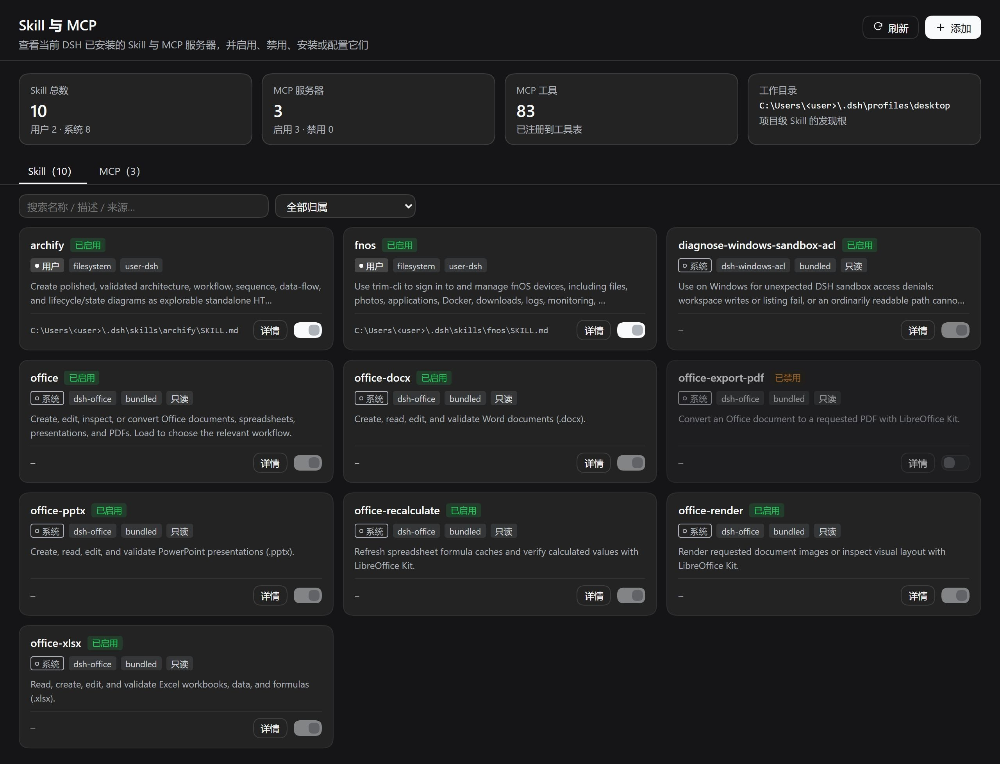
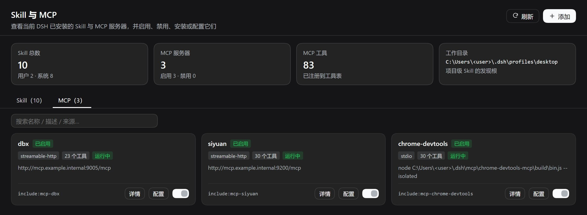
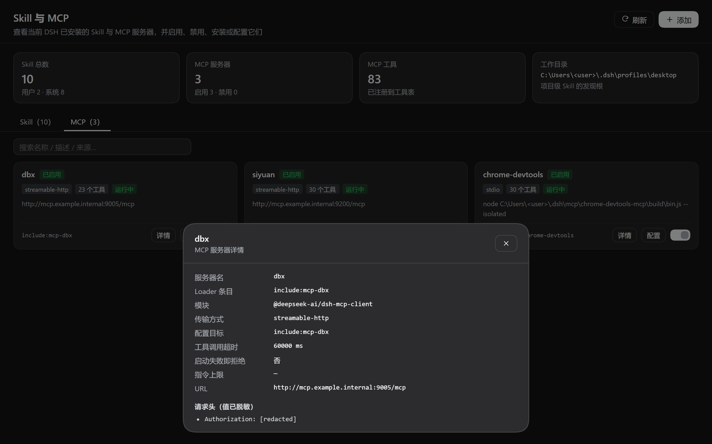
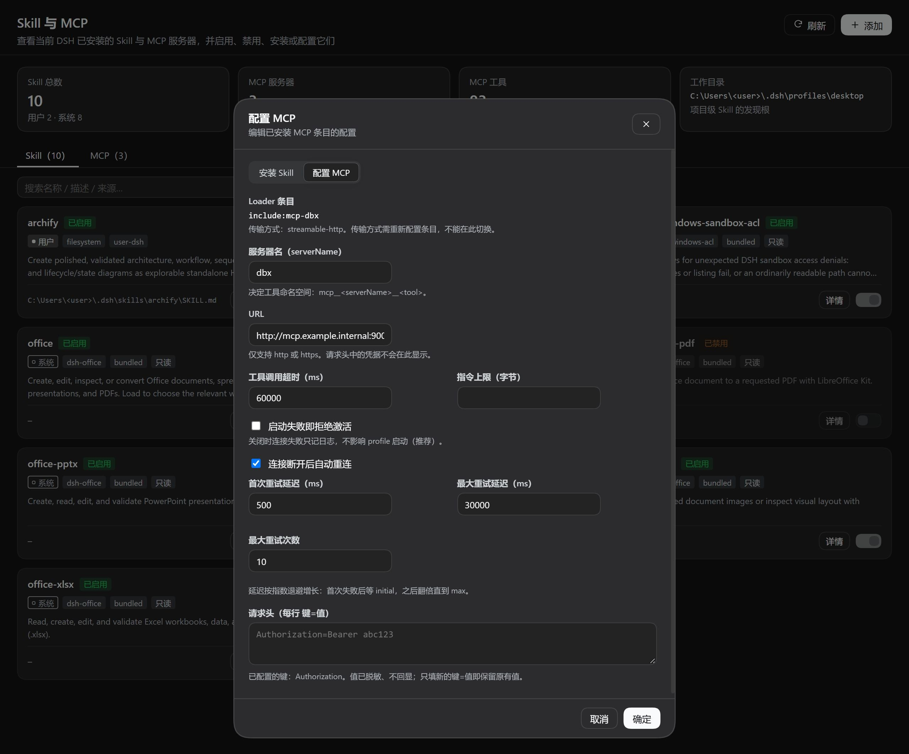

# dsh-skill-mcp-list

> 在 DSH 里一眼看清所有 Skill 与 MCP，并直接开关它们。

**dsh-skill-mcp-list** 是 [DeepSeek Harness](https://github.com/deepseek-ai) 的插件：把当前 DSH 已安装的 **Skill** 与 **MCP 服务器**汇总成一份可读、可搜、可操作的卡片清单，支持查看详细信息、一键启用 / 禁用、安装新 Skill 与配置已装 MCP。



<p align="center">
  <sub>用户自装 Skill 排在首位，系统内置技能随后；卡片自带归属徽标与启停开关</sub>
</p>

如果这个插件帮你省下了翻配置文件的时间，**欢迎点一个 Star ⭐** —— 这是对作者最直接的鼓励，也能让更多 DSH 用户发现它。

---

## 目录

- [功能](#功能)
- [界面](#界面)
- [安装](#安装)
- [使用](#使用)
- [工作原理](#工作原理)
- [安全设计](#安全设计)
- [配置](#配置)
- [开发](#开发)
- [常见问题](#常见问题)
- [已知限制](#已知限制)
- [许可证](#许可证)

---

## 功能

| 能力 | 说明 |
|---|---|
| **汇总查询** | 一次拿到全部 Skill（来自项目 / 用户 / bundled / runtime 全部提供方）与全部 MCP 服务器，并标注每个 Skill 的归属：**系统**还是**用户** |
| **详细信息** | Skill：名称、描述、来源、提供方、指令文件路径、资源目录、调用面、指令正文<br>MCP：服务器名、传输方式、命令 / 参数 / URL、超时、重连策略、已注册工具清单、Fiber 阶段 |
| **启用 / 禁用** | Skill 与 MCP 均可开关，状态**持久化**，重启后依然生效 |
| **安装 Skill** | 弹窗表单创建新 Skill（名称 / 描述 / whenToUse / 指令正文），落盘到用户 skill 根即被自动发现 |
| **配置 MCP** | 弹窗编辑已安装 MCP 条目：serverName、传输参数（命令 / 逐行参数 / 工作目录 或 URL）、环境变量 / 请求头、超时、指令上限、启动失败行为、自动重连（含退避参数） |
| **双入口** | Web 侧边栏图形面板 + 模型工具 `skill_mcp_list`，两条通道能力对等 |
| **凭据脱敏** | MCP 配置中的 `env`、`headers`、URL 查询参数、命令行参数一律脱敏后才对外返回 |

## 界面

侧边栏（与「插件」「定时任务」同级）新增入口 **Skill 与 MCP**，点击后在主区域打开管理页。

### Skill 清单


- 顶部四张统计卡：Skill 总数、MCP 服务器数、MCP 工具数、当前工作目录
- 两个标签页：**Skill** / **MCP**
- **响应式卡片栅格**：宽屏多列、窄屏自动收为单列。每张卡片四段信息层级——① 名称 + 状态徽标　② 归属 / 提供方 / 来源等标签　③ 两行截断的描述　④ 路径与操作区（详情 / 开关）
- 支持按名称 / 描述 / 来源实时搜索，并按**归属**筛选（全部 / 用户 / 系统）
- 每张 Skill 卡片带归属徽标：**用户**（来自用户或项目的 skill 根，品牌色实心点）与**系统**（随 DSH 发行版或运行时提供，中性空心点）
- **用户自装 Skill 排在首位**，系统内置技能随后，组内按名称升序

### MCP 服务器



- 卡片展示传输方式、已注册工具数、Fiber 阶段（运行中 / 加载失败 / 未加载）与只读原因
- stdio 条目显示命令与参数，http 条目显示脱敏后的 URL
- 每张卡片提供 **详情**、**配置** 与启停开关

### 详情与配置

| 详情弹窗 | 配置弹窗 |
|---|---|
|  |  |
| 展示完整字段：MCP 为脱敏后的请求头 / 环境变量与工具清单，Skill 为指令正文 | 头部 **「＋ 添加」** 打开，可在「安装 Skill」与「配置 MCP」之间切换；表单带前端校验、提交中反馈与成功 / 失败提示 |

界面完全复用 DSH 设计令牌（`--dsw-alias-*`），自动跟随明暗主题。

> 截图中的用户名、内网地址与凭据均已替换为示例值（`<user>`、`example.internal`、`[redacted]`）。

## 安装

通过官方 CLI 安装到指定 profile：

```bash
dsh plugin --profile <profile> add dsh-skill-mcp-list
```

本地开发时可直接指向源码目录：

```bash
dsh plugin --profile <profile> add /absolute/path/to/dsh-skill-mcp-list
```

安装会写入 profile 的 `dependencies` 与 `dsh.profile.bundles`，并自动并入本包的 `cordis.patch.yml` 层。桌面版 profile 由应用独占管理，安装后需重启应用生效。

> 也可以手动在 profile 的 `cordis.patch.yml` 追加一条 `- id: skill-mcp-list` / `name: dsh-skill-mcp-list` 完成挂载。

## 使用

### Web 面板

打开侧边栏的 **Skill 与 MCP**，在卡片上直接拨动开关、点「详情」查看完整信息，或点「配置」编辑该 MCP 条目。

头部「＋ 添加」默认停在 **「配置 MCP」**（已装条目更常需要调整），自动选中第一个 MCP 条目；若 profile 里一个 MCP 都没有，则回退到「安装 Skill」。

安装新 Skill：点头部「＋ 添加」→ 切到「安装 Skill」→ 填写名称与描述 → 确定。新 Skill 会写入用户 skill 根（默认 `$DSH_HOME/skills`），随后自动出现在列表中。

### 模型工具

```
skill_mcp_list(action="list")                             # 全量清单 + 统计
skill_mcp_list(action="summary")                          # 只要计数
skill_mcp_list(action="detail", target="archify")         # 单个 Skill 详情
skill_mcp_list(action="detail", target="mcp-dbx")         # 单个 MCP 详情
skill_mcp_list(action="disable_skill", target="archify")  # 禁用 Skill
skill_mcp_list(action="enable_skill",  target="archify")  # 启用 Skill
skill_mcp_list(action="disable_mcp",   target="mcp-dbx")  # 禁用 MCP
skill_mcp_list(action="enable_mcp",    target="mcp-dbx")  # 启用 MCP
skill_mcp_list(action="install_skill", spec={ name: "my-skill", description: "做了什么", body: "# 步骤" })            # 安装 Skill
skill_mcp_list(action="configure_mcp",  target="mcp-dbx", config={ toolCallTimeoutMs: 120000, failOnStartupError: true })  # 配置 MCP
```

`field` 参数可选择改哪个调用面：`model`（默认，模型侧目录）或 `user`（人类侧命令）。
`cwd` 参数用于指定发现项目级 Skill 的工作目录。

## 工作原理

插件只做「读取既有状态」与「写入既有配置」，不发明新的存储格式。

### Skill 的启停

DSH 的 Skill 由 `ctx.skills` 注册表统一提供，注册表本身是只读的——Skill 的调用面由 `SKILL.md` 的 YAML frontmatter 决定：

| frontmatter 键 | 缺省 | 含义 |
|---|---|---|
| `disable-model-invocation` | `false` | 为 `true` 时模型侧不可见、不可加载 |
| `user-invocable` | `true` | 为 `false` 时人类侧命令不可见 |

因此本插件的启停是**行级改写 frontmatter**：

- **禁用** → 写入显式值（`disable-model-invocation: true`）
- **启用** → **删除该键行**，恢复 DSH 默认的「允许」，而不是写入 `false`

写入采用「同目录临时文件 + rename」的原子替换，避免半截文件被 Skill 监视器读到而误判为无效 Skill。改写后立即通过 `ctx.skills.get()` 复核（注册表每次加载都重读文件，因此状态立刻反映，无需等待监视器）。

只有落在地面文件系统、且提供方暴露了指令文件路径的 Skill 才能切换；bundled 与 runtime 提供方的 Skill 在界面上标记为「只读」并拒绝写入。

### MCP 的启停

profile 中每个 MCP 服务器都是 `@deepseek-ai/dsh-mcp-client` 的一个 Loader 条目。插件读取这些条目的配置与运行状态，启停则**完全委托官方 `ctx.pluginManager.setPluginEnabled()`**——由它原子地写入 profile 的 `cordis.patch.yml` 并触发 HMR 重载。

插件自身不直接改配置文件，因此不会与官方插件管理器产生写冲突。

### MCP 的配置

配置走官方 `ctx.configEditor.edit()`：它用条目自身的 Config schema 校验完整候选值，保留 YAML 注释与 `!!js` 表达式，并在写盘失败时回滚到旧补丁。

弹窗只放行白名单字段，且要求传输方式自洽——stdio 条目不能填 URL、http 条目不能填命令，换传输方式需重新配置条目。这避免了写出「加载即失败」的配置。

### Skill 的可见性（作用域视角）

Skill 注册表是**分层**的：读取结果 = 全局层 + 调用方作用域链。官方把每个 agent preset 的 `skill-filesystem` 注册在该 preset 的作用域层里，因此**不带视角的 `list()` 只看得到 bundled 等部署级提供方**。

插件按三级优先级解析视角：

| 优先级 | 来源 | 场景 |
|---|---|---|
| 1 | `exec.agent` | 模型工具调用（agent 对象本身就是其作用域键） |
| 2 | `sessionId` → `ctx.agents.get()` | Web 面板（面板注入 `sessions` 取当前会话） |
| 3 | `agentPresets.acquireScope()` | 拿不到会话时读默认 preset 的 standing 作用域，用完归还租约 |
| 兜底 | 全局层 | 三者皆不可用（精简 profile）；快照标记 `view.globalOnly` |

### Skill 归属：系统 vs 用户

面板与模型工具都会标注每个 Skill 的归属，判定依据是提供方给出的 `source`（不靠路径猜测）：

| 归属 | 来源 | 含义 |
|---|---|---|
| **系统** | `bundled`、`provider: runtime` | 随 DSH 发行版分发或运行时注册，没有可写的磁盘文件 |
| **用户** | `user-dsh`、`user-agents`、`project-dsh`、`project-agents`、`custom` | 你或项目在 skill 根里写下的 SKILL.md |

未知来源保守判为**系统**：把不确定的东西标成"用户"，比标成"系统"更容易误导运维判断。

面板与模型工具的清单都按**用户在前、系统在后**排序，组内按名称升序——自己写的 skill 是当前项目的工作内容，内置技能只是发行版底座，因此排在后面。徽标样式也随之区分：系统为中性描边 + 空心点，用户为品牌色软底 + 实心点。

### MCP 可编辑字段

弹窗按传输方式给出对应字段，且只放行官方 `dsh-mcp-client` 的既有配置项：

| 字段 | stdio | streamable-http | 说明 |
|---|:--:|:--:|---|
| `serverName` | ✓ | ✓ | 决定工具命名空间 `mcp__<serverName>__<tool>` |
| `command` / `args` / `cwd` | ✓ | — | 参数**逐行**填写，含空格的参数不会被拆散 |
| `env` | ✓ | — | 每行 `键=值`；已有键只显示键名，值不回显 |
| `url` | — | ✓ | 仅 http / https |
| `headers` | — | ✓ | 每行 `键=值`；已有键只显示键名，值不回显 |
| `toolCallTimeoutMs` | ✓ | ✓ | 工具调用超时 |
| `maxInstructionBytes` | ✓ | ✓ | 服务器指令上限 |
| `failOnStartupError` | ✓ | ✓ | 关闭时连接失败只记日志，不影响 profile 启动 |
| `reconnect` | ✓ | ✓ | 开关 + 首次延迟 / 最大延迟 / 最大重试次数 |

映射字段（`env` / `headers`）采用**按键合并**语义：只提交你填的键，其余键原样保留；提交 `键: null` 表示删除该键。这样面板无需知道既有凭据的明文，也能安全地增删单个键值。

传输方式本身不可在此切换（stdio 与 http 的配置结构不同），交叉填写会被拒绝——例如给 stdio 条目填 `headers` 会提示改用 `env`。

### MCP 条目的配置结构

profile 的 `cordis.patch.yml` 是**补丁层**，语义由官方 `applyEntryPatches()` 决定：

- **新增**条目必须写成 `- insert:` + 缩进的条目列表；
- 不带 `insert` 的行是**按 `id` 覆盖**，目标行不存在时只写一条 Loader warning 后**静默跳过**。

因此新增 MCP 服务器时要写 `insert:`，否则启动后既没有报错、也没有条目——面板会如实显示 0 台。

### Skill 的安装

新 Skill 写入用户 skill 根（priority 最高优先级为项目级根，安装固定落在 `user-dsh`）。`dsh-skill-filesystem` 通过监视器自动发现新目录，无需重启。同名 Skill 会被拒绝而不是覆盖。

### 数据通道

- **模型工具**：`ctx.tools.register()`，读操作免权限，写操作申请一次性权限升级
- **Web 面板**：注册 exact 路由 `/api/skill-mcp-list`（GET 快照 / POST 变更）

## 安全设计

| 措施 | 说明 |
|---|---|
| **权限升级** | 所有写操作先经 `approveEscalation()` 申请 `danger-full-access`，与官方 `plugin_manager` 工具同一姿态；用户拒绝或审批通道不可用时**直接失败，绝不绕过** |
| **凭据脱敏** | `env` / `headers` 的值一律不外传（只暴露键名）；URL 移除 userinfo、遮蔽敏感查询参数；命令行参数中的 Bearer 令牌与 `key=value` 形式凭据同样遮蔽 |
| **信任栅栏** | HTTP 路由挂在 `/api` 下且为 exact，优先于官方在 `/api` prefix 上的栅栏，因此自行调用 `connection.requestRejection()` 执行同一套同源 + 浏览器认证校验；**拿不到栅栏服务时返回 503 而不是放行** |
| **写入边界** | 只允许写入 `SKILL.md` 或以 `.md` 结尾的指令文件；目标路径来自注册表解析结果，不接受调用方任意指定 |
| **请求体上限** | HTTP 请求体上限 256 KiB，超限拒绝，避免无界缓冲 |

## 配置

插件本身无需配置。可选字段：

| 字段 | 默认 | 含义 |
|---|---|---|
| `cwd` | 进程工作目录 | 发现项目级 Skill 的默认工作目录 |

```yaml
- id: skill-mcp-list
  name: dsh-skill-mcp-list
  config:
    cwd: E:\WorkSpace\Projects
```

## 开发

```bash
npm test          # 运行全部测试
```

测试分十个文件，共 129 个用例：

| 文件 | 用例 | 覆盖 |
|---|---|---|
| `tests/core.test.mjs` | 20 | 纯逻辑：frontmatter 改写（幂等 / CRLF / 重复键 / 拒绝无 frontmatter）、凭据脱敏、投影与统计 |
| `tests/api.test.mjs` | 10 | API 层：真实临时文件系统上的读写、只读目标拒绝、无 `pluginManager` 降级 |
| `tests/http.test.mjs` | 10 | HTTP 层：信任栅栏、fail-closed、方法分发、错误映射、请求体上限 |
| `tests/scope.test.mjs` | 8 | 作用域视角：agent / sessionId / preset 三级解析、租约归还、全局层降级、视角披露 |
| `tests/mount.test.mjs` | 12 | 真实 Cordis 挂载：工具注册、卸载注销、读写路径、权限拒绝、install/configure 端到端、preset 层合并 |
| `tests/client.test.mjs` | 2 | 客户端 bundle 契约与页面渲染（含最小 React 垫片） |
| `tests/install.test.mjs` | 25 | 安装 / 配置纯逻辑：Skill Markdown 生成与转义、名称校验、MCP 补丁白名单与传输自洽 |
| `tests/install-api.test.mjs` | 15 | 安装 / 配置 API 层：落盘、重复拒绝、非法名拒绝、configEditor 委托、DSH home 反推 |
| `tests/install-http.test.mjs` | 6 | 安装 / 配置 HTTP 层：新 action 落盘、缺服务降级、非法补丁不写盘、栅栏仍生效 |
| `tests/client-cards.test.mjs` | 21 | 卡片栅格四段层级、响应式断点、归属排序、弹窗开关 / 表单校验 / 成功反馈 / 失败保留 |

`mount` 与 `http` 两个文件需要 DSH 运行时包。首次运行前执行：

```bash
node scripts/fetch-runtime.mjs
```

该脚本从本机 DSH 安装中按依赖闭包提取所需的 `@deepseek-ai/*` 包到 `.runtime/`。未提取时这两个文件的用例会自动跳过，其余测试照常运行。

### 源码结构

```
lib/core.mjs     纯逻辑：frontmatter 行级改写、凭据脱敏、投影与统计（零依赖）
lib/api.mjs      宿主 API 层，不导入任何 @deepseek-ai/*，可独立测试
lib/index.mjs    Cordis 接线：工具注册、HTTP 路由、权限升级
lib/install.mjs  安装 / 配置纯逻辑：SKILL.md 生成、MCP 补丁校验（零依赖）
lib/client.js    Web 面板（预构建浏览器 bundle：卡片栅格 + 弹窗）
```

## 常见问题

**Q：为什么启用 Skill 是「删除配置行」而不是写 `false`？**
A：DSH 中这两个键**缺省即允许**。写 `disable-model-invocation: false` 虽然等效，但会在用户的 `SKILL.md` 里留下冗余行；删除键行可让文件逐字节回到原始状态，便于 diff 与版本管理。

**Q：为什么有些 Skill 的开关是灰的？**
A：bundled 与 runtime 提供方的 Skill 没有可写的磁盘文件，无法持久化启停状态。详情弹窗会说明具体原因。

**Q：为什么有些 MCP 条目不能切换？**
A：官方插件管理器只允许修改「可寻址」的条目（在 profile patch 中有唯一匹配项）。管理组件自身、agent preset 内的条目等为只读，详情会给出 `readOnlyReason`。

**Q：改了之后要重启吗？**
A：不需要。Skill 状态即时生效；MCP 通过官方 HMR 重载，同样即时生效。

**Q：为什么面板里的 Skill 比系统提示里的少？**
A：Skill 的可见性按**作用域链**合并。官方把每个 agent preset 的 `skill-filesystem` 注册在该 preset 的作用域层里（`@deepseek-ai/dsh-web-app` 的宿主层行是 `disabled: true`，`presets/*.patch.yml` 各自重新挂载），而注册表读取是「全局层 + 调用方作用域链」的合并。因此**不带视角**的 `list()` 只看得到 bundled 等部署级提供方。本插件用 `exec.agent`（工具路径）或会话 id（面板路径）解析视角；两者都拿不到时借 `agentPresets.acquireScope()` 取默认 preset 的 standing 作用域。若读数仍偏少，检查统计卡第三行的提示：显示「仅全局层」即表示视角未解析成功。

**Q：面板显示「已启用」但模型看不到 Skill？**
A：请确认改的是 `model` 调用面。若之前用 `field: user` 禁用过，模型侧仍然可见——两个调用面相互独立。

**Q：为什么需要在 profile 里启用宿主层的 `skill-filesystem`？**
A：这是本插件的**全局清单视角**依赖的部署级配置。官方 web-app bundle 把宿主层 `skill-filesystem` 行置为 `disabled: true`（presets 各自挂载），于是用户侧 Skill 只存在于 preset 作用域层。若插件宿主代码尚未重启加载（DSH 的插件模块只在进程启动时导入，而 Web 面板随文件 mtime 热更新），面板就会出现「用户 Skill 不显示」。在 profile 的 `cordis.patch.yml` 追加以下三行可使其注册进全局层，与 preset 层按 skill 名合并、不产生重复：

```yaml
- id: skill-filesystem
  name: '@deepseek-ai/dsh-skill-filesystem'
  disabled: false
```

配置层是热生效的（改完无需重启）；作用域视角修复加载后此行仍可保留，两者互补。代价是多一个文件监听器。

## 已知限制

- **Skill 启停依赖文件系统提供方**：bundled / runtime Skill 只读。
- **不新建存储**：插件不维护自己的状态文件，一切以 DSH 现有配置为准；因此外部工具直接改配置时，面板需刷新才能反映。
- **MCP 条目需可寻址**：受官方插件管理器的 `readOnlyReason` 约束。
- **项目级 Skill 依赖 `cwd`**：未传 `cwd` 时按进程工作目录发现。
- **前后端版本可能短暂错配**：Web 面板的 bundle 版本由文件 mtime/size 推导，改动后浏览器刷新即生效；宿主模块只在进程启动时导入。因此在"改了插件但未重启 DSH"的窗口期内，面板可能比宿主新。面板对此做了兜底——归属标识与计数会在本地按 `source` 重新推导，不依赖宿主新增字段；但**属视角、MCP 字段等宿主侧能力仍需重启后才完整生效**。
- **无视角时只看得到全局层**：拿不到 agent 或会话、且 `agentPresets` 服务缺失时（例如精简 profile），只能列出 bundled Skill；快照的 `view.globalOnly` 会如实标记。
- **MCP 只配置、不新增**：新增 MCP 条目需要向 profile 追加 insert 行并触发 reconcile，官方未开放该 API（`configEditor` 只能编辑已存在条目）。绕过它会与官方插件管理器的文件锁和 HMR 排他锁冲突，因此本插件不支持新增 MCP 服务器。
- **MCP 传输方式不可切换**：stdio 与 streamable-http 的配置结构不同，切换需重新配置条目。
- **桌面版 profile 由应用独占**：安装 / 卸载需通过应用或官方 CLI，插件无法在运行中自行改 profile 依赖。

## 许可证

[MIT](LICENSE)

---

如果这个插件对你有用，**再提醒一次：Star ⭐ 是作者持续维护的最大动力。**
